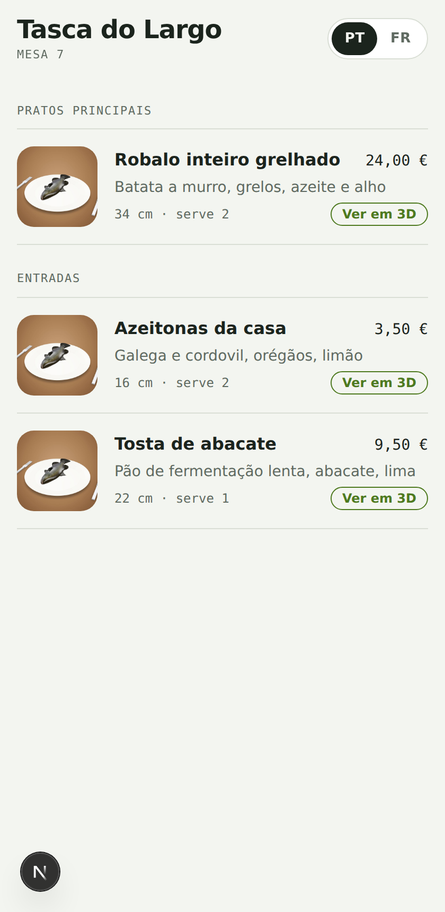
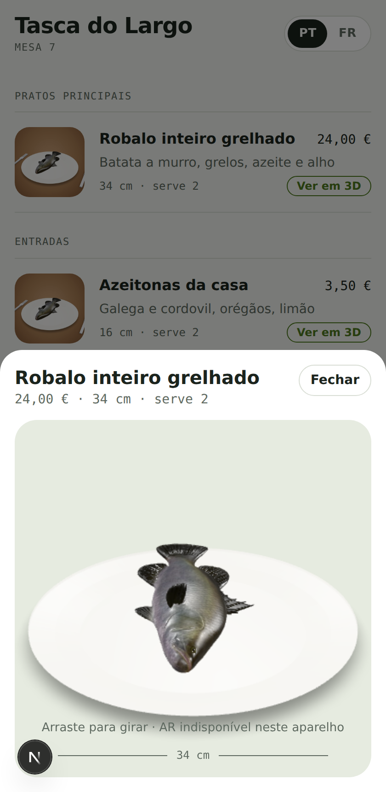
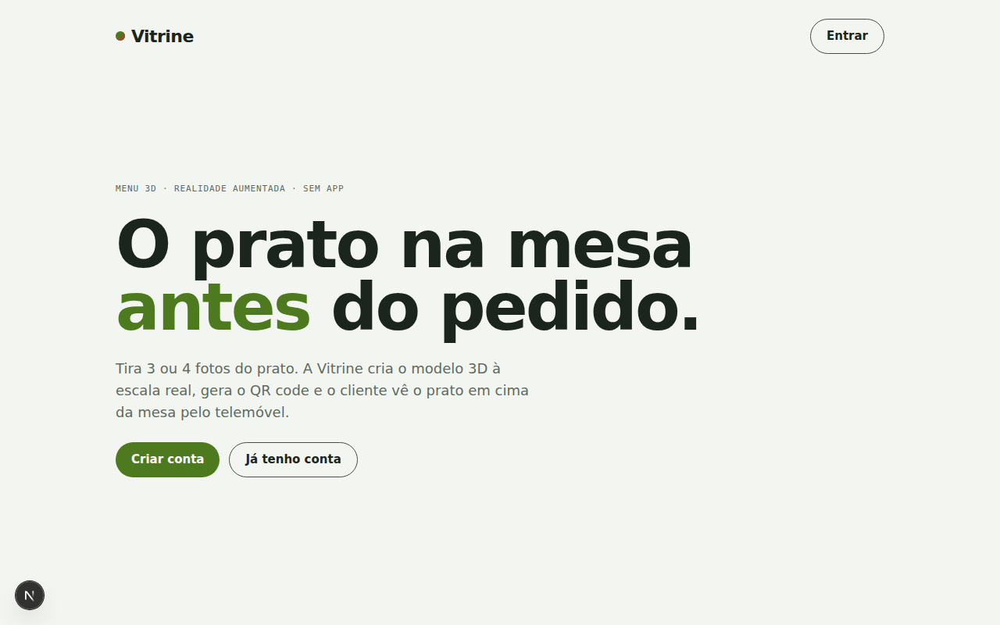

# Vitrine — menu 3D e realidade aumentada para restaurantes

O restaurante tira 3 ou 4 fotos de um prato. A aplicação transforma-as num modelo 3D,
põe-no à escala real e gera os QR codes. O cliente lê o QR na mesa e vê o prato em
cima da própria mesa, em tamanho real, pelo telemóvel — sem instalar nenhuma app.

<p align="center">
  
  
</p>



## Porquê

Uma fotografia não mostra a dose. O cliente não sabe se o prato dá para partilhar
ou chega para uma pessoa, e essa dúvida trava o pedido. Em 3D à escala real
a dúvida desaparece.

## Como funciona

```
3–4 fotos ──▶ Supabase Storage ──▶ Meshy (multi-image-to-3d) ──▶ .glb
                                         │  2 a 5 min
   o painel pergunta de 5 em 5 s ────────┘
                                         ▼
                        escala real (largura em cm) + base em y=0
                                         ▼
                     menu público  ──QR──▶  telemóvel do cliente
                                         ├─ iPhone: AR Quick Look
                                         └─ Android: Scene Viewer / WebXR
```

A peça que dá sentido ao produto é a escala: o `.glb` que a Meshy devolve tem um
tamanho arbitrário, e é reescrito para medir exatamente a largura em centímetros
que o dono mediu no prato, centrado e pousado em `y = 0`.

## Tecnologias

| Camada | Escolha |
|---|---|
| Aplicação | Next.js 16 (App Router), React 19, TypeScript |
| Estilos | Tailwind CSS 4 |
| Dados, contas e ficheiros | Supabase — PostgreSQL com Row Level Security, Auth, Storage |
| Fotos → 3D | [Meshy](https://docs.meshy.ai/en/api/multi-image-to-3d) |
| Escala do modelo | glTF-Transform |
| 3D e AR no browser | [`<model-viewer>`](https://modelviewer.dev) |
| QR codes | `qrcode` |
| Validação | Zod |
| Testes | Vitest |

## Segurança

- **Row Level Security** em todas as tabelas: um restaurante não lê nem altera
  os pratos de outro, e a regra está na base de dados, não apenas no código.
- **Campos fechados** com Zod: `model_url`, `meshy_task_id`, `published` e
  `restaurant_id` são escritos só pelo servidor, nunca vêm do formulário.
- **Limite de utilização** por utilizador no que custa dinheiro: 10 modelos 3D
  por hora e 40 por dia, contados numa tabela (`usage_counters`), para um clique
  repetido não esvaziar a conta da Meshy.
- **Respostas cortadas**: o menu público devolve só os campos que mostra —
  nunca `owner_id`, `meshy_task_id` ou pratos por publicar.
- **Chaves secretas** (`SUPABASE_SECRET_KEY`, `MESHY_API_KEY`) só no servidor.
- **Funções `SECURITY DEFINER` fechadas**: o PostgreSQL dá `EXECUTE` a toda a
  gente por omissão e o Supabase expõe as funções como endpoints — sem o
  `REVOKE`, qualquer pessoa com a chave pública podia encher o contador de
  limites de outro utilizador, ou apagá-los todos para escapar aos limites.
- **Downloads com travões**: estado HTTP verificado, 80 MB de limite e tempo
  máximo, para um erro do fornecedor não chegar ao leitor de 3D como se fosse
  um modelo nem ocupar a memória do servidor.

## Pôr a correr

```bash
npm install
cp .env.example .env.local     # preencher com as chaves
npm run dev
```

1. **Supabase**: criar projeto, abrir o SQL Editor e correr `supabase/schema.sql`
   (tabelas, políticas RLS, buckets e funções).
2. **Meshy**: para experimentar sem gastar créditos, usar a chave de teste
   `msy_dummy_api_key_for_test_mode_12345678`, que devolve sempre um modelo de exemplo.
3. **Pôr online** (Vercel): colar as cinco variáveis do `.env.local` e pôr em
   `NEXT_PUBLIC_SITE_URL` o endereço final — é o que vai dentro dos QR codes.

> A realidade aumentada só funciona em `https://`. Em `localhost` vê-se o 3D, não a AR.

## Revisão de segurança

O que foi testado contra ataque real, e não só lido:

| Verificação | Como |
|---|---|
| Um dono não lê, altera, publica nem apaga nada de outro | 19 asserções em `tests/integration/rls.sql`, contra um PostgreSQL verdadeiro |
| Roubo de restaurante (mudar o dono) e inserir pratos em casa alheia | tentado no teste, recusado pela base |
| Contadores de limites invisíveis e inalteráveis pelos clientes | linha semeada fora do RLS; o cliente continua a ver zero |
| Funções `SECURITY DEFINER` fechadas | o teste tenta chamá-las como visitante e tem de levar erro |
| Limites de tamanho na base (largura 2–150 cm, nomes até 120) | inserções inválidas recusadas |
| Segredos fora do código do browser | `npm run check:bundle` percorre o que é servido ao cliente; validado com um teste negativo |
| Dependências vulneráveis | `npm audit --omit=dev --audit-level=high` no CI |

O que **não** está verificado: teste de penetração por terceiros, testes de ponta
a ponta com contas reais, e comportamento sob carga.

## Verificações

```bash
npm run lint       # ESLint
npm run typecheck  # TypeScript em modo estrito
npm run test       # Vitest
npm run build      # build de produção
npm run check:bundle  # nenhum segredo no código enviado ao browser

# políticas de segurança contra um PostgreSQL a sério
createdb vitrine_test
psql "postgresql://…/vitrine_test" -v ON_ERROR_STOP=1 -f tests/integration/rls.sql
```

Os testes cobrem a parte que não pode falhar em silêncio: a escala do modelo
(largura exata, base em `y = 0`, ficheiro sem geometria recusado), as validações
de entrada e o cálculo das janelas de limite.

O `tests/integration/rls.sql` vai mais longe: cria a base, dois donos e um
visitante anónimo, e prova em 9 verificações que um dono não lê, altera nem
apaga os pratos do outro, que o público só vê o que está publicado, que
ninguém carrega fotos para a pasta de outro restaurante, e que as funções
`SECURITY DEFINER` não estão abertas ao público. É a única forma de provar políticas de
segurança — a olho, não se vê.

Tudo isto corre no GitHub Actions em cada push (`.github/workflows/ci.yml`).

## Mapa do código

| Caminho | O que faz |
|---|---|
| `supabase/schema.sql` | tabelas, RLS, buckets e funções |
| `src/lib/scale-model.ts` | põe o `.glb` à escala real |
| `src/lib/meshy.ts` | cria e consulta as tarefas na Meshy |
| `src/lib/model-pipeline.ts` | acompanha a tarefa e guarda o resultado |
| `src/lib/rate-limit.ts` | contador de utilização por janela |
| `src/lib/contracts/dish.ts` | esquemas Zod dos formulários |
| `src/app/painel/**` | painel do restaurante |
| `src/app/m/[slug]/**` | menu que o cliente vê |
| `src/app/api/dishes/[id]/model` | polling do estado do modelo |
| `src/components/ModelViewer.tsx` | visualizador 3D e botão de AR |

## Estado

Projeto pessoal, em desenvolvimento. O que está verificado: build, tipos, testes,
as políticas RLS contra uma base PostgreSQL local, e o menu com dados simulados.
Por verificar contra serviços reais: o ciclo completo com uma conta Supabase e
uma chave paga da Meshy.

## Nota

Projeto meu, na ideia, no produto e nas decisões — preços, funcionalidades,
prioridades. O código foi escrito com ajuda de IA (Claude), e eu revi e testei
o resultado. Achei mais honesto dizê-lo aqui do que fingir o contrário.

## Licença

MIT — ver [LICENSE](./LICENSE).
